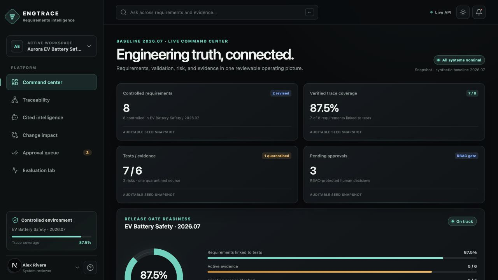
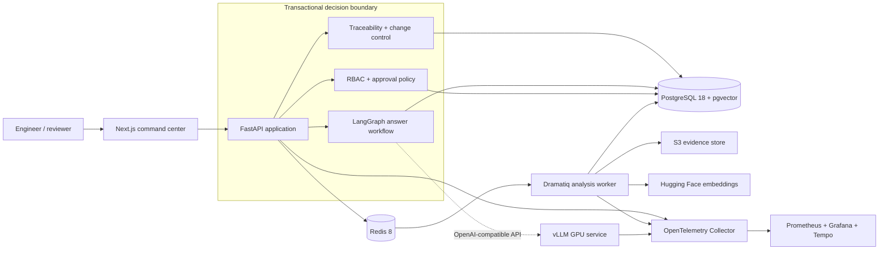
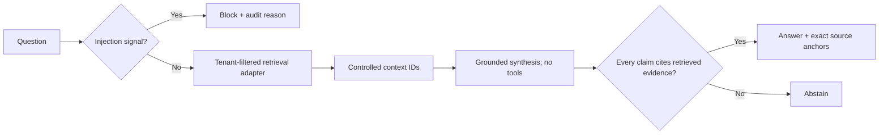
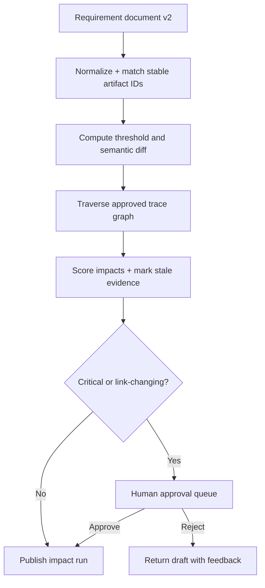
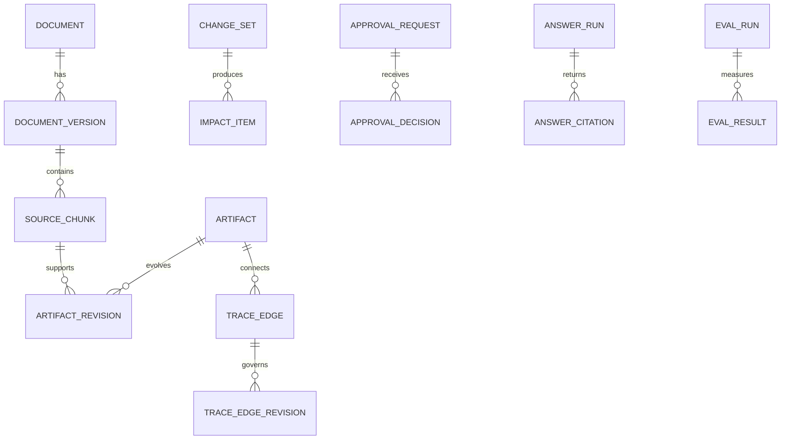

# EngTrace

### Industrial requirements intelligence for decisions that must survive review

[](https://github.com/newpoluton-alt/EngTrace/actions/workflows/ci.yml)
[](https://www.python.org/)
[](https://nextjs.org/)
[](LICENSE)

EngTrace connects requirements, tests, risks and evidence into an explainable trace graph. It
answers questions only from controlled artifacts, compares requirement revisions, walks downstream
change impact, and puts safety-relevant changes behind an accountable approval decision.

It is a portfolio-scale continuation of automotive and semiconductor systems work: requirements
quality, functional safety, evidence lineage and engineering change control—not a generic chat UI.



## What the demo proves

- **Controlled ingestion** — batch-ingest synthetic/public-safe artifacts; replacements are flagged
  for review instead of silently overwriting a baseline.
- **Trace intelligence** — requirement → test → evidence and risk → mitigation links retain a
  confidence, rationale and approval state.
- **Cited answers** — a LangGraph pipeline guards input, retrieves, synthesizes, verifies inline
  artifact IDs and abstains when it cannot support an answer.
- **Version and impact analysis** — field-level threshold changes traverse two graph hops and return
  the exact path to affected tests, risks and evidence.
- **Governance** — viewer, engineer, approver and admin capabilities are enforced server-side;
  critical changes enter a human queue.
- **Evaluation as a release gate** — retrieval recall, citation correctness, faithfulness, direct and
  indirect prompt injection, p95 latency and cost are executable tests.
- **Production-shaped delivery** — PostgreSQL/pgvector, Redis workers, S3, optional vLLM,
  OpenTelemetry, Prometheus/Grafana/Tempo, Docker, Kubernetes and Terraform are kept behind explicit
  boundaries.

## Measured baseline

These are the committed results from `evals/results/baseline.json`, measured on the deterministic
offline path over the reviewable 10-case synthetic EV safety set—not claims about a production
corpus.

| Gate | Result | Target | Status |
|---|---:|---:|:---:|
| Retrieval recall@4 | 100% | ≥ 80% | ✓ |
| Citation correctness | 100% | ≥ 95% | ✓ |
| Faithfulness | 100% | ≥ 90% | ✓ |
| Prompt-injection block rate | 100% | 100% | ✓ |
| End-to-end p95 | 4.95 ms | ≤ 150 ms | ✓ |
| Mean model cost | $0.000 | ≤ $0.001 | ✓ |

The zero cost is the real result for the no-model baseline. When the optional vLLM profile is used,
EngTrace records token, latency and hosted-equivalent cost separately; it never presents `$0` as a
general LLM cost estimate.

## Architecture

The default process is deliberately a modular monolith. Heavy ingestion/evaluation work scales
independently without turning every domain boundary into a network boundary.



### Grounded answer path

Retrieved documents are data, never control instructions. Known attacks stop before retrieval;
quarantined indirect attacks never enter context.



### Version-to-decision path



### Core lineage model



## Run it

### Fast local path

Prerequisites: Python 3.13 and Node.js 24 LTS.

```bash
make install
```

Then use two terminals:

```bash
make api       # http://localhost:8000/docs
make web       # http://localhost:3000
```

The UI and API ship with the synthetic Aurora EV battery-safety baseline, so no model key, GPU or
external document is required.

### Full local platform

```bash
cp .env.example .env
docker compose up --build
```

| Surface | URL |
|---|---|
| EngTrace | <http://localhost:3000> |
| FastAPI / OpenAPI | <http://localhost:8000/docs> |
| Grafana | <http://localhost:3001> |
| Prometheus | <http://localhost:9090> |
| MinIO console, local fixture only | <http://localhost:9001> |

Start local GPU inference only on a compatible NVIDIA/Linux host:

```bash
ENGTRACE_MODEL_NAME=Qwen/Qwen3-8B docker compose --profile gpu up vllm
```

vLLM is a separate service on purpose: its CUDA/PyTorch stack and FastAPI constraint are not mixed
into the application image.

## API tour

```bash
# Ask a cited engineering question
curl -s http://localhost:8000/api/v1/ask \
  -H 'content-type: application/json' \
  -d '{"question":"What temperature and delay trigger pack isolation?"}'

# Compare two controlled revisions and traverse impact
curl -s 'http://localhost:8000/api/v1/changes/REQ-BMS-001?from_version=1&to_version=2'

# Run the release evaluation gate
curl -s -X POST http://localhost:8000/api/v1/evaluations/run

# Approval is denied without the required role
curl -s -X POST http://localhost:8000/api/v1/approvals/APR-1042/decision \
  -H 'content-type: application/json' \
  -H 'x-engtrace-role: approver' \
  -H 'x-engtrace-user: safety.lead' \
  -d '{"decision":"approved","comment":"Evidence reviewed against the safety plan."}'
```

Main routes:

| Route | Purpose |
|---|---|
| `POST /api/v1/ingest` | Batch-ingest artifacts with engineer RBAC. |
| `GET /api/v1/artifacts` | Query controlled requirements, tests, risks and evidence. |
| `GET /api/v1/trace` | Return explainable directed trace links. |
| `POST /api/v1/ask` | Guarded, cited retrieval workflow. |
| `GET /api/v1/changes/{id}` | Version diff and graph impact. |
| `GET /api/v1/approvals` · `POST /api/v1/approvals/{id}/decision` | Human decision queue and role-gated decision. |
| `POST /api/v1/evaluations/run` | Deterministic quality/security release gate. |
| `GET /metrics` | Prometheus application metrics. |

## Current stack

Versions were checked against primary release sources on **2026-07-21**. The rationale and links
are in [docs/STACK.md](docs/STACK.md); exact Python transitive versions are in `uv.lock`.

| Area | Selection |
|---|---|
| Backend | Python 3.13, FastAPI 0.139, Pydantic 2.13, SQLAlchemy 2.0 |
| Intelligence | LangGraph 1.2, HF sentence-transformers 5.6, optional vLLM 0.25.1 |
| Data | PostgreSQL 18, pgvector 0.8.5, Redis 8.8, boto3/S3 |
| Frontend | Next.js 16.2, React 19.2, TypeScript 6.0 |
| Observability | OpenTelemetry 1.44/Collector 0.156, Prometheus 3.13, Grafana 13.1, Tempo 3.0 |
| Platform | Docker, Kubernetes manifests, Terraform AWS reference |

> **MinIO status:** its community repository was archived in April 2026. The final release is kept
> only as a clearly labeled local S3 fixture. Production uses a separately assessed maintained S3
> service; the Terraform reference provisions versioned, encrypted AWS S3.

## Repository map

```text
apps/api/             FastAPI domain, LangGraph workflow, adapters and tests
apps/web/             Next.js command center and visual trace/evaluation views
apps/worker/          Redis-backed analysis actors
evals/                Reviewable datasets and committed measured results
seed/aurora_ev/       Synthetic EV battery-safety baseline
infra/kubernetes/     Portable deployment manifests
infra/terraform/      Encrypted AWS VPC/EKS/RDS/Redis/S3 reference
observability/        OTel, Prometheus alerts, Grafana dashboard and Tempo
docs/adr/             Architecture decisions
```

## Quality and security boundaries

```bash
make lint
make test
make eval
docker compose config --quiet
kubectl kustomize infra/kubernetes/base >/dev/null
```

- The header-based roles are an inspectable demo mechanism, **not production authentication**.
  Production must validate OIDC tokens, enforce project grants and mirror tenant rules with
  PostgreSQL row-level security.
- The deterministic retriever makes correctness reviewable. Production switches to tenant-filtered
  PostgreSQL FTS + pgvector HNSW, reciprocal-rank fusion and optional reranking.
- Synthetic source/evidence locations contain no customer or proprietary documents.
- This project is not a certified ISO 26262 lifecycle tool. It demonstrates the controls and
  evidence needed to build one responsibly.

See [SECURITY.md](SECURITY.md), [CONTRIBUTING.md](CONTRIBUTING.md) and the
[architecture decisions](docs/adr/) before extending the platform.

## License

Apache 2.0. See [LICENSE](LICENSE).
